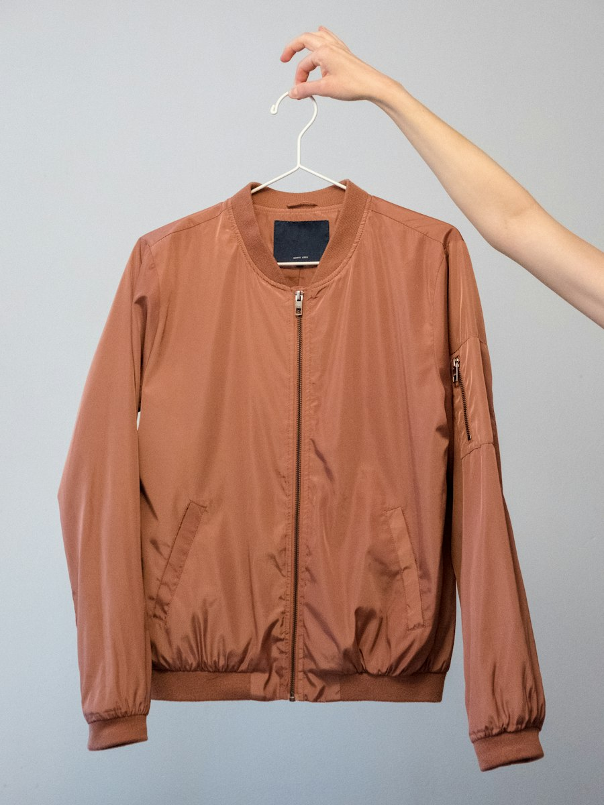
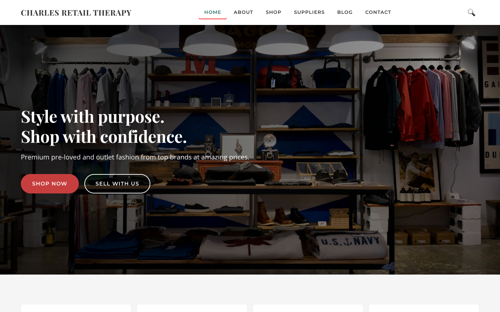
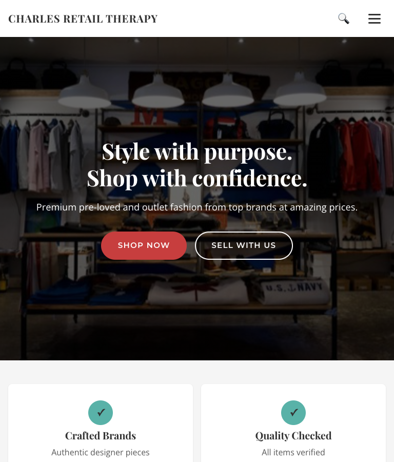
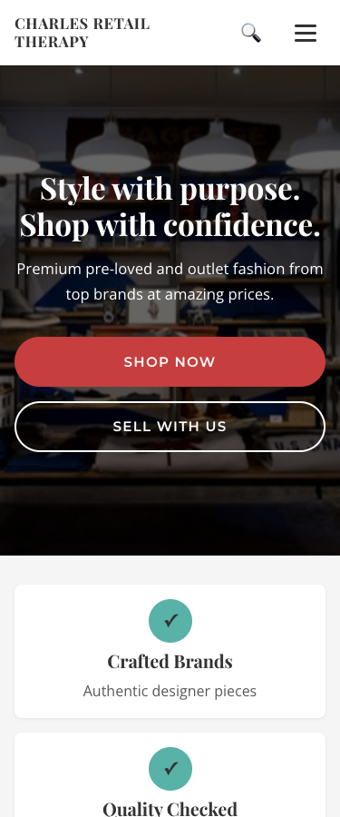
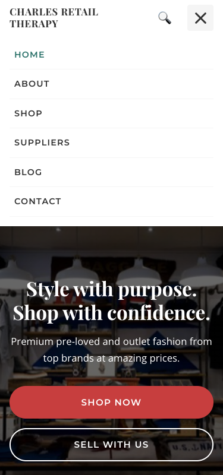

# Charles Retail Therapy – E-Commerce Website Development


## 1. Project Title
**Charles Retail Therapy – Website Development Project**

---

## 2. Student Information
- **Student Name:** Tshiamo Mzimande
- **Student Number:** ST10505753@rcconnect.edu.za
- **Course/Module:** WEDE5020
- **Institution:** Rosebank Internationl
- **Date Submitted:** 21 August 2026

---

## 3. Project Overview (Complete)
Charles Retail Therapy is a South African-based business that sources second-hand luxury and sportswear brands from wealthy individuals who donate or sell items at low cost. The business resells these items to students and young professionals who desire high-end fashion but cannot afford retail prices. While the business has operated successfully through word-of-mouth and local pop-up events, it has never had an online presence.

This project involves the design and development of a fully functional e-commerce website for Charles Retail Therapy. The website will serve as an online storefront, enabling customers to browse products, make purchases, and engage with the brand. It will also include a supplier onboarding channel and a blog for sustainability and style content. The goal is to increase brand awareness, expand geographic reach, and generate online sales while promoting a circular economy.

---

## 4. Website Goals and Objectives

### Strategic Goals
1. Increase brand awareness and attract new customers across South Africa (especially in Durban, Johannesburg, and Cape Town).
2. Generate online sales by enabling direct product purchases.
3. Attract more suppliers by showcasing the business’s reach and credibility.
4. Provide customers with easy access to product catalogues, pricing, and availability.

### Key Performance Indicators (KPIs)
| KPI | Target |
|-----|--------|
| Monthly website visitors | 5,000 within 3 months |
| Online conversion rate | 2% of visitors making a purchase |
| Supplier enquiry forms submitted | Measured monthly |
| Average session duration & bounce rate | Monitored for engagement |
| Social media referral traffic | Tracked via analytics |

---

## 5. Key Features and Functionality

### Essential Pages
| Page | Description |
|------|-------------|
| **Homepage** | Hero banner with featured products, brand highlights, and a clear call-to-action (e.g., "Shop Now"). |
| **Shop/Products Page** | Categorised by brand, product type, and size. Filters for price, condition, and colour. |
| **Product Detail Page** | High-quality images, description, condition grade, price, and "Add to Cart" button. |
| **About Us** | The brand story, mission, sustainability angle, and team information. |
| **Supplier Page** | Information for potential suppliers with a contact/enquiry form. |
| **Contact Us** | Phone, email, physical address (if any), and a contact form. |
| **Cart & Checkout** | Secure checkout with payment gateway integration (Yoco or PayFast). |
| **Blog/News** | Style tips, sustainability content, and new arrivals. |

### E-Commerce Functionality
- Secure payment gateway integration.
- Guest checkout option to reduce friction.
- Clear "Condition Guide" for second-hand item grading.
- Quick-view feature on product hover.

---

## 6. Timeline and Milestones

| Milestone | Duration | Deliverables |
|-----------|----------|--------------|
| 1. Project Kick-off & Discovery | Week 1 | Finalised sitemap, wireframes, and design mockups |
| 2. Design Approval | Week 2 | Approved colour scheme, typography, and homepage design |
| 3. Front-end Development | Weeks 3–4 | Responsive HTML/CSS templates for all pages |
| 4. Back-end & E-commerce Setup | Weeks 5–6 | Product database, shopping cart, payment gateway integration |
| 5. Content Population | Week 7 | Upload products, images, descriptions, about us, and supplier page |
| 6. Testing & QA | Week 8 | Cross-browser, mobile, payment, and user acceptance testing |
| 7. Launch | Week 9 | Website goes live, domain pointed, and analytics set up |
| 8. Post-Launch Support | Week 10 | Bug fixes and training for the owner |

---

## 7. Sitemap

---

## 8. Styling – External Stylesheet (`style.css`)

### 8.1 Linking the stylesheet
Every page links the same external stylesheet (plus Google Fonts) inside `<head>`:

```html
<link rel="preconnect" href="https://fonts.googleapis.com">
<link rel="preconnect" href="https://fonts.gstatic.com" crossorigin>
<link rel="stylesheet" href="https://fonts.googleapis.com/css2?family=Montserrat:wght@500;600;700&family=Open+Sans:wght@400;600&family=Playfair+Display:wght@600;700&display=swap">
<link rel="stylesheet" href="style.css">
```

### 8.2 Stylesheet structure
`style.css` is written **mobile-first** and split into numbered, commented sections:

1. CSS Reset · 2. Custom Properties · 3. Base Typography · 4. Links · 5. Buttons · 6. Layout Helpers · 7. Header & Navigation · 8. Hero · 9. Homepage Sections · 10. Inner Page Header · 11. About · 12. Shop · 13. Blog · 14. Suppliers & Contact · 15. Forms · 16. Images · 17. Footer · 18. Utilities · 19. Animations · 20. Media Queries · 21. Reduced Motion · 22. Print

All classes and IDs use kebab-case (e.g. `.site-header`, `.nav-link`, `.product-item`, `#main-nav`).

### 8.3 Colour palette
| Role | Variable | Colour | Used for |
|------|----------|--------|----------|
| Primary | `--color-primary` | Warm Grey `#8C8C8C` | Borders, form outlines, dividers |
| Secondary | `--color-secondary` | Soft Teal `#59B2A8` | Page headers, icons, footer links |
| Accent | `--color-accent` | Coral `#FF6B6B` | Highlights, quote marks, active nav underline |
| Text | `--color-text` | Charcoal `#333333` | Body text, footer background |
| Background | `--color-white` | White `#FFFFFF` | Page background, cards |
| Section background | `--color-light` | Light Grey `#F5F5F5` | Alternating sections |

**Accessible shades.** Some brand colours are too light for text on white, so darker shades are used where text must be read:

| Combination | Contrast | WCAG AA (4.5:1) | Fix |
|-------------|----------|-----------------|-----|
| White on Coral `#FF6B6B` | 2.78:1 | Fail | Buttons use `#C73E3E` (5.02:1) |
| Teal `#59B2A8` text on white | 2.51:1 | Fail | Links use `#2A7169` (5.73:1) |
| Warm Grey `#8C8C8C` text on white | 3.36:1 | Fail for text | Grey only used for borders (3:1 rule for UI parts) |
| Charcoal on Soft Teal | 5.03:1 | Pass | Used on page headers |
| Teal / Coral on Charcoal footer | 5.03:1 / 4.55:1 | Pass | Footer links |

### 8.4 Typography
| Element | Font | Size |
|---------|------|------|
| h1 | Playfair Display | `clamp(2rem, …, 3rem)` |
| h2 | Playfair Display | `clamp(1.75rem, …, 2.5rem)` |
| h3 | Playfair Display | `clamp(1.375rem, …, 1.75rem)` |
| h4 | Playfair Display | 1.25rem |
| h5, h6 | Montserrat, uppercase | 1rem / 0.875rem |
| Nav, buttons, labels | Montserrat | 0.8–0.95rem |
| Body | Open Sans | 1rem, line-height 1.7 |

### 8.5 Example HTML structure (homepage)
```html
<body>
  <a class="skip-link" href="#main-content">Skip to main content</a>

  <header class="site-header">
    <div class="container">
      <div class="logo"><h1><a href="index.html" class="logo-link">CHARLES RETAIL THERAPY</a></h1></div>
      <button class="nav-toggle" aria-expanded="false" aria-controls="main-nav">
        <span class="sr-only">Open menu</span>
        <span class="hamburger-bar"></span><span class="hamburger-bar"></span><span class="hamburger-bar"></span>
      </button>
      <nav class="main-nav" id="main-nav" aria-label="Main navigation">
        <ul class="nav-list">
          <li><a href="index.html" class="nav-link active" aria-current="page">Home</a></li>
          <li><a href="products.html" class="nav-link">Shop</a></li>
        </ul>
      </nav>
      <a href="products.html" class="search-icon" aria-label="Search products">🔍</a>
    </div>
  </header>

  <main id="main-content">
    <section class="hero">                      <!-- background image + overlay -->
      <div class="container">
        <div class="hero-content">
          <h2>Style with purpose.</h2>
          <div class="hero-actions">
            <a href="products.html" class="btn-primary">Shop Now</a>
            <a href="suppliers.html" class="btn-secondary">Sell With Us</a>
          </div>
        </div>
      </div>
    </section>

    <section class="new-arrivals">
      <div class="container">
        <h2>NEW ARRIVALS</h2>
        <div class="product-grid">             <!-- auto-fit grid -->
          <div class="product-item">
            <div class="product-image">
              
            </div>
            <h4>Nike Jacket</h4>
            <p class="price">R899</p>
          </div>
        </div>
      </div>
    </section>

    <section class="testimonials">
      <div class="container">
        <div class="testimonial-grid">
          <figure class="testimonial-card">
            <blockquote class="testimonial-quote"><p>…</p></blockquote>
            <figcaption class="testimonial-author">Student, Durban</figcaption>
          </figure>
        </div>
      </div>
    </section>
  </main>

  <footer class="site-footer">
    <div class="container">
      <div class="footer-content">…</div>   <!-- grid columns -->
      <div class="footer-bottom">…</div>
    </div>
  </footer>
</body>
```

### 8.6 Key CSS decisions
- **Custom properties in `:root`.** Colours, fonts, spacing (`--space-xs` 0.5rem to `--space-xl` 6rem), radius and shadows are defined once, so the whole theme can be changed in one place.
- **Mobile-first.** Base styles are for phones; `min-width` queries add columns and the horizontal menu as space grows. Phones download the least CSS work and the smallest images.
- **Grid for 2D layouts, Flexbox for 1D.** Card grids, footer and two-column contact/supplier wrappers use Grid; the header, nav, buttons and brand list use Flexbox.
- **`repeat(auto-fit, minmax(min(300px, 100%), 1fr))`.** Cards reflow from 1 to 3+ columns with no media queries. The `min(300px, 100%)` stops a 300px card overflowing on a 320px phone (the container is only 288px wide there).
- **`clamp()`** for headings and section padding, so sizes scale smoothly between a minimum and maximum instead of jumping at breakpoints.
- **Container width** is `min(100% - 2rem, 1200px)`, giving a 1rem gutter on small screens and a 1200px max on desktop (1320px at 1440px+).
- **Hero** uses a CSS background image with a dark gradient overlay (text contrast stays above 4.5:1). A 480px image loads on phones, 900px on tablets and 1600px on desktops.
- **Responsive images.** Product and blog images use `srcset` + `sizes`; About and Suppliers images use `<picture>` with a mobile `<source>`. All images have `width`/`height` to prevent layout shift, `loading="lazy"`, and descriptive `alt` text.
- **Hamburger menu.** A real `<button>` with `aria-expanded` and `aria-controls`, toggled by `functions.js` (Escape closes it). If JavaScript is off, the `.no-js` class keeps the menu visible.
- **Interaction states.** `:hover`, `:focus-visible`, `:active`, `:visited` and `:disabled` are styled on links, buttons and form fields, with 0.3s transitions.
- **Animations.** `fadeInUp` on the hero text and a 3-cycle `pulse` on the Shop Now button. All motion is switched off under `prefers-reduced-motion`.
- **Accessibility.** Skip link, `.sr-only` labels, visible focus rings, 44px touch targets, 16px form text (stops iOS zoom), and `aria-hidden` on decorative emoji icons.
- **Print styles** hide navigation and buttons, and print black text on white.

---

## 9. Responsive Design & Testing

### 9.1 Breakpoints
| Breakpoint | Query | What changes |
|------------|-------|--------------|
| Base (mobile-first) | none | Single-column grids, hamburger menu, 480px hero image |
| Small mobile | `max-width: 480px` | Full-width buttons, tighter card padding |
| Mobile / tablet | `max-width: 768px` | Scrollable dropdown menu |
| Tablet landscape + | `min-width: 769px` | Horizontal nav, 900px hero image, 3-column map |
| Desktop | `min-width: 1024px` | Shop sidebar, two-column contact/supplier forms, left-aligned hero, 1600px hero image |
| Large desktop | `min-width: 1440px` | Wider container (1320px), slightly larger body text |

### 9.2 Responsive testing checklist
- [ ] No horizontal scrolling at 320px, 375px, 768px, 1024px or 1440px
- [ ] Hamburger menu appears at 768px and below, opens/closes, and closes with Escape
- [ ] Horizontal navigation appears from 769px up; current page is underlined
- [ ] Hero text is readable over the image at every width
- [ ] Product, blog and testimonial cards stack to one column on mobile
- [ ] Shop filters sit beside products from 1024px, above them on smaller screens
- [ ] Contact and supplier forms are two columns from 1024px, stacked below
- [ ] All images load, keep their proportions and are not blurry
- [ ] Buttons and links are at least 44px tall on touch screens
- [ ] Tab key moves through links in order with a visible focus ring; "Skip to main content" appears on first Tab
- [ ] Form fields show a teal focus ring; invalid email shows a red border after typing
- [ ] With "reduce motion" turned on in the OS, nothing animates
- [ ] Print preview (Ctrl/Cmd + P) shows clean black-and-white content without the menu
- [ ] Tested in Chrome, Firefox, Safari and Edge

### 9.3 Testing with browser developer tools
1. Open the site with **Live Server** in VS Code (right-click `index.html` → *Open with Live Server*).
2. Open DevTools: **F12** or **Ctrl + Shift + I** (Windows) / **Cmd + Option + I** (Mac).
3. Turn on the device toolbar: **Ctrl + Shift + M** / **Cmd + Shift + M** (or click the phone/tablet icon).
4. Set the **Dimensions** dropdown to *Responsive* and type each width into the width box:

| Width | Represents | What to check |
|-------|------------|---------------|
| **320px** | Small phone (iPhone SE 1st gen) | Nothing cut off or scrolling sideways; logo wraps neatly; buttons full width |
| **375px** | Standard phone (iPhone SE / 13 mini) | Hamburger menu works; cards are single column |
| **768px** | Tablet portrait (iPad) | Still the hamburger menu; cards in 2 columns where space allows |
| **1024px** | Tablet landscape / small laptop | Horizontal nav; shop sidebar; two-column forms |
| **1440px** | Desktop | Content centred at max width; 1600px hero image is sharp |

5. To check for horizontal scrolling, run this in the **Console** tab. It should print `true`:
   ```js
   document.documentElement.scrollWidth <= document.documentElement.clientWidth
   ```
6. Test reduced motion: **More tools → Rendering → Emulate CSS media feature prefers-reduced-motion → reduce**.
7. Test print: **Rendering → Emulate CSS media type → print**.
8. Check contrast: inspect a text element, click the colour swatch in the **Styles** panel, and read the contrast ratio (AA needs 4.5:1).
9. Run **Lighthouse** (DevTools → Lighthouse → Accessibility) for an automatic accessibility score.

### 9.4 Screenshots
To take a screenshot in DevTools, set the width, then open the command menu (**Ctrl/Cmd + Shift + P**) and run **"Capture screenshot"** (visible area) or **"Capture full size screenshot"** (whole page). Save them in the `screenshots/` folder.

| View | Width | Screenshot |
|------|-------|-----------|
| Desktop | 1440px |  |
| Tablet | 768px |  |
| Mobile | 375px |  |
| Mobile menu open | 375px |  |

---

## 10. Image Credits
Product, blog and background photos are free stock images from [Unsplash](https://unsplash.com) (Unsplash License). Smaller `-480.jpg` versions were resized for mobile `srcset`.
